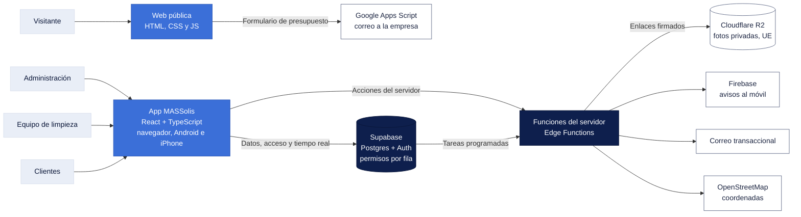
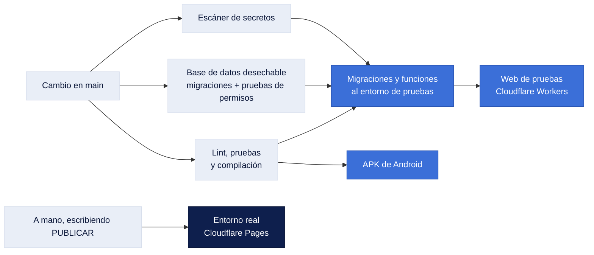

  

<h1 align="center">MASSolis · web y app de operaciones</h1>

  <b>Empresa de limpieza y desinfección en Sevilla.</b> 
  Web pública en producción y app de gestión con panel de administración, app móvil para el equipo y portal del cliente.

  <a href="https://massolis.com">massolis.com</a> ·
  <a href="https://github.com/alex85biri/massolis-web">Código de la web</a> ·
  Código de la app: privado, acceso de lectura bajo petición

  
  
  
  
  
  

---

## Estado

| | Estado |
| --- | --- |
| **Web pública** · [massolis.com](https://massolis.com) | ✅ **Publicada y en uso** desde el 8 de noviembre de 2026 (diseño iniciado en junio de 2026) |
| **App de operaciones** | 🛠️ **En pruebas**, con datos inventados. Lanzamiento en preparación |

Este repositorio explica **cómo está montado** MASSolis. No contiene código de la app, claves ni datos de clientes o del personal: el código real está en un repositorio privado porque maneja datos personales.

## En cifras

| | Web | App |
| --- | --- | --- |
| Estado | Publicada en massolis.com | En pruebas; preparando el lanzamiento |
| Inicio | Diseño y prototipos desde junio de 2026 (Marian López Solís y Gustavo Tapia) · Primera versión de Marian · Publicada y ampliada desde el 8 de noviembre de 2026 | 1 de noviembre de 2026 |
| Cambios en el historial | 35 | Más de 150 |
| Calidad | Auditoría de accesibilidad WCAG 2.2 AA | Pruebas automáticas: más de 100 casos en la app y más de 700 comprobaciones en la base de datos |
| Base de datos | — | 34 migraciones, más de 30 tablas, todas con permisos por fila |
| Publicación | Automática al subir cambios | Automática al entorno de pruebas si pasan todas las comprobaciones; manual y confirmada al entorno real |

## Arquitectura general

Una sola base de código sirve las tres interfaces de la app. El tipo de cuenta decide qué interfaz se abre, y la base de datos decide qué datos puede ver cada cuenta.

## Las piezas

### Web pública: massolis.com

Diseño y prototipos desde junio de 2026, de Marian López Solís y Gustavo Tapia. La primera versión, con el sistema de diseño y la auditoría de accesibilidad, es de Marian; la publicación con dominio propio y la ampliación (formulario de presupuesto, posicionamiento y opiniones verificadas), de Gustavo.

- **HTML, CSS y JavaScript sin framework.** Carga rápida, sin dependencias y fácil de mantener.
- **Sistema de diseño propio**: colores, tipografías (Plus Jakarta Sans e Instrument Serif) y componentes compartidos.
- **Posicionamiento en Google**: páginas por servicio, datos estructurados de schema.org, `sitemap.xml`, `robots.txt`, `llms.txt` y alta en Search Console.
- **Accesibilidad**: auditada con WCAG 2.2 AA, el nivel que pide la norma europea.
- **Formulario de presupuesto** que llega al correo de la empresa a través de Google Apps Script, sin servidor propio.
- **Opiniones verificadas**: solo se muestran reseñas reales, con su origen.
- **Publicación** en GitHub Pages con dominio propio.

### App: tres interfaces, una base de código

| Interfaz | Quién la usa | Qué hace |
| --- | --- | --- |
| Panel de administración | Dirección | Clientes, espacios, equipo, agenda, servicios periódicos y de varios días, ausencias, incidencias, recibos y ajustes |
| App del profesional | Equipo de limpieza | Servicios del día, fichaje por servicio, tareas del manual, fotos del antes y el después, incidencias y mensajes. Funciona sin conexión |
| Portal del cliente | Clientes | Seguimiento de sus servicios, solicitudes, servicios extra con presupuesto, mensajes, valoraciones y descarga de sus recibos |

**Tecnologías:** React 19, TypeScript, Vite, Tailwind CSS 4, React Router, TanStack Query (datos del servidor y caché), Zustand (estado local) y Capacitor 8 para las apps de Android e iPhone.

**Decisiones destacables:**

- **Cola sin conexión.** Si el móvil pierde la cobertura, las acciones y las fotos se guardan en el móvil y se envían solas al volver.
- **Tiempo real por canales privados.** Los cambios llegan al momento, y solo a quien tiene permiso.
- **Responsive real.** Diseño propio para móvil, tablet y ordenador.

### Servidor y datos: Supabase

- **Postgres con permisos por fila (Row Level Security) en todas las tablas.** El navegador nunca decide qué datos ve nadie: lo decide la base de datos.
- **Migraciones versionadas.** La base de datos se puede crear desde cero en cualquier momento, y así se hace en cada cambio para comprobarla.
- **Registros que no se editan ni se borran**: fichajes, correcciones de horas, historial de cada servicio y mensajes. Cada cambio deja quién, cuándo y por qué.
- **Hora de Madrid en el servidor.** Fechas y horarios se comparan siempre en la zona horaria de la empresa, no en la del móvil.
- **Tareas programadas** con `pg_cron` y `pg_net`: resumen diario para administración, coordenadas de las direcciones y avisos de errores.
- **Siete funciones del servidor** (Deno, Edge Functions):

| Función | Para qué |
| --- | --- |
| Invitar | Da de alta a una persona y le envía la invitación |
| Fotos | Da enlaces firmados, de pocos minutos, para subir y ver fotos tras comprobar permisos |
| Recibos | Genera el recibo en PDF o Excel y lo envía por correo |
| Avisos | Envía los avisos al móvil con Firebase |
| Resumen diario | Correo y aviso a las 7:00 con lo pendiente del día |
| Coordenadas | Calcula la ubicación aproximada de cada dirección para estimar kilómetros |
| Soporte | Formulario de soporte del panel al correo de la empresa |

### Fotos

Se guardan en **Cloudflare R2, en la Unión Europea**, en un almacén **sin acceso público**. Para subir o ver una foto, la app pide permiso a una función del servidor. Esa función lo comprueba en la base de datos y devuelve un enlace firmado que caduca en minutos. La subida no puede sobrescribir una foto que ya existe.

## Seguridad

- **Nadie se registra solo.** Administración invita a cada persona.
- **Doble verificación obligatoria para administración.** Sin ella, la base de datos no concede permisos de administración.
- **Mensajes que no revelan si un correo existe** en el acceso y en la recuperación de contraseña.
- **Cada interfaz tiene su propio acceso.** Una cuenta que intenta entrar por el acceso de otro tipo de cuenta queda fuera.
- **Ninguna clave privada** en el código ni en el historial. Un escáner de secretos (gitleaks) revisa el repositorio en cada cambio.
- **Pruebas de permisos automáticas** para cada tipo de cuenta, incluida administración sin la doble verificación.

## Cómo se publica

- **Si un paso falla, los siguientes no se hacen.** La web nueva nunca se publica con pruebas fallidas ni antes que la base de datos que necesita.
- **Las pruebas de base de datos se ejecutan en GitHub**, en una base de datos desechable creada desde cero.
- **La app de Android se compila en la nube** con cada cambio en la rama principal. La de iPhone se compila en un Mac de GitHub y se sube a TestFlight, sin necesidad de un Mac propio.
- **El entorno real no se publica solo.** Hay que lanzarlo a mano y confirmarlo, y pasa antes por las mismas comprobaciones.

## Copias de seguridad

Montadas y programadas desde noviembre de 2026 para el entorno real, que estará vacío hasta el lanzamiento. Se activan del todo con él.

Probadas el 21/11/2026 en el entorno de pruebas: restauración de 75 tablas y 428 filas sin diferencias y 8 de 8 fotos idénticas. La copia programada del entorno real funciona desde el 22/11/2026.

- **Cada noche**, la base de datos y las fotos del entorno real se copian **cifradas** a un almacén privado en Europa.
- **La restauración se prueba de forma automática cada mes**: se descarga la última copia, se descifra, se restaura en una base de datos vacía y se compara tabla a tabla y foto a foto.
- **Si una copia falla o no se hace**, llega un aviso por correo y la propia app lo detecta. Sin el aviso configurado, la copia se niega a ejecutarse, para que un fallo nunca pase desapercibido.

## Forma de trabajar

- **Por fases**, cada una con criterios de «hecho» que se pueden comprobar: arranque, datos y permisos, acceso, operación, app del profesional, portal del cliente, recibos y lanzamiento.
- **Revisión independiente al cerrar cada fase**, con informe de hallazgos y corrección antes de seguir.
- **Registro de decisiones** con fecha y motivo para todo lo que cambia el alcance o la arquitectura.
- **Prototipo aprobado como referencia.** La app parte de un prototipo validado con la empresa y lo va sustituyendo pantalla a pantalla por datos reales.
- **Desarrollo asistido por IA.** El código se ha escrito con Claude Code, con la arquitectura, las decisiones y la revisión a mi cargo.

## Versiones

### App

| Versión | Fecha | Qué trajo |
| --- | --- | --- |
| prototipo-v1 | 01/11/2026 | Prototipo aprobado, punto de partida |
| v0.1 | 01/11/2026 | Proyecto real: conexión con Supabase, comprobaciones automáticas y entorno de pruebas publicado |
| v0.2 | 01/11/2026 | Núcleo de la base de datos con permisos por fila y sus pruebas |
| v0.3 | 08/11/2026 | Acceso real: invitaciones, doble verificación y recuperación de contraseña |
| v0.4 | 11/11/2026 | Panel de administración con datos reales: clientes, equipo, agenda y servicios periódicos |
| v0.5 | 12/11/2026 | App del profesional: Android, cola sin conexión, fotos en R2, tiempo real y avisos al móvil |
| v0.6 | 12/11/2026 | Portal del cliente: solicitudes, extras con presupuesto, mensajes y valoraciones |
| v0.7 | 13/11/2026 | Recibos en PDF y Excel con envío por correo, y diseño para tablet |
| v0.8 | 17/11/2026 | Entorno real separado, y copias cifradas cada noche con restauración automática cada mes, programadas |

### Web

| Versión | Fecha | Qué trajo |
| --- | --- | --- |
| v1.0 | 08/11/2026 | Primera versión, de Marian López Solís: sistema de diseño y auditoría de accesibilidad. El mismo día, publicación con dominio propio y formulario de presupuesto |
| v1.1 | 09/11/2026 | Enlaces limpios, «Sobre nosotros» e Instagram |
| v1.2 | 13/11/2026 | Opiniones reales verificadas |
| v1.3 | 17/11/2026 | Páginas por servicio para Google, menú de servicios y pie nuevo |

## Sobre el código privado

La app gestiona datos personales de clientes y del equipo, así que su código está en un repositorio privado. Si quieres comprobar el trabajo, puedo darte **acceso de lectura temporal**: escríbeme por LinkedIn.

---

MASSolis · Solución sostenible · Sevilla

